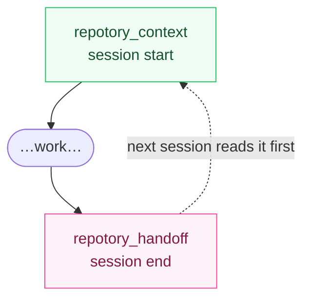

# Repotory Skill

Repotory is a local-first, cross-agent project memory layer. It discovers local Git repositories, maintains a cross-project knowledge base (Markdown notes, FTS5 search, version history), mines repository knowledge, and exposes it to AI agents via the MCP server and llms.txt export.

## Session Memory Protocol

The tools form a session loop. Use it in every working session on a Repotory-tracked project:



0. **First run**: on a fresh install call `repotory_scan` once — it seeds the default scan roots and scans them synchronously, so the knowledge base is populated without ever opening the desktop app. Call it again any time `repotory_context` reports no projects. (Humans: `node scripts/repotory-init/index.mjs --with-hook` registers the MCP server and the SessionEnd handoff hook in one command — see ADR-0009.)
1. **Start**: call `repotory_context` once — it returns tech stack, README excerpt, dependencies, recent commits, open todos and the most relevant notes (previous session handoffs lead). This replaces chaining `projects_list` → `notes_search` → `notes_read`.
2. **End**: call `repotory_handoff` with `summary` (required) plus any of `changes` / `decisions` / `gotchas` / `next_steps`. The note is tagged `handoff` and the next session reads it first — regardless of which agent wrote it.
   - Handoff notes are protocol records: `repotory_notes_update` refuses to overwrite them (write a new handoff instead), and `repotory_context` renders the latest one in full.
   - To make step 2 fire automatically instead of relying on the agent remembering, wire a Claude Code `SessionEnd` hook — one bounded headless turn at session end (see `docs/features/ai-integration.md`).

## Recommended AI Workflow

```
0. First run        → repotory_scan                  → discover repos, populate the knowledge base
1. Load context     → repotory_context               → session cold start, one call
2. Search projects  → repotory_projects_list        → find relevant repos
3. Search knowledge → repotory_notes_search / repotory_ask  → find existing notes
4. Read details     → repotory_notes_read            → read a specific note
5. Create knowledge → repotory_notes_create          → capture new insights
6. Update knowledge → repotory_notes_update          → refine existing notes
7. End session      → repotory_handoff               → structured handoff for the next session
8. Check readiness  → repotory_agent_score           → verify AI integration health
9. Check the data   → repotory_integrity             → when results look incomplete
```

**When search comes back suspiciously thin**, run `repotory_integrity` before
concluding the knowledge base is thin. An FTS index that drifted out of sync
with the notes table makes every search silently under-report, and
`repotory_agent_score` will still say everything is fine — it checks
installation readiness, not whether the data is true.

**Typical scenario**: "Help me understand project X"
1. `repotory_context({ project_name: "X" })` — one call loads everything known about the project
2. `repotory_notes_read({ id })` — expand on any note the context surfaced
3. `repotory_handoff({ project_id, summary, changes, next_steps })` — save what you learned when done

**Typical scenario**: "What do I know about topic Y?"
1. `repotory_notes_search({ query: "Y" })` — full-text search across all notes
2. `repotory_ask({ query: "Y" })` — semantic search with top-5 results
3. `repotory_notes_read({ id })` — read the most relevant note in detail

## What Repotory Does

- **Repository discovery**: Automatically finds Git repos under configurable scan roots
- **Daily activity tracking**: Lines added/deleted, files changed, commit counts per repo (365-day backfill on demand)
- **Knowledge base**: Cross-project Markdown notes with tags, pins, version history + LCS diff
- **Full-text search**: SQLite FTS5 trigram + bm25 ranking across notes and todos
- **Claude memory import**: Idempotent import of `~/.claude/projects/*/memory/*.md`
- **Repo knowledge mining**: README excerpt, tech stack, languages, dependencies, contributors, activity
- **AI context export**: `llms.txt` and per-note `.md` export

## MCP Server (`repotory-mcp`)

MCP is the single AI execution interface (the `repotory` CLI is not shipped). stdio server, opens the database once per process. The desktop app is **not** required — `repotory-mcp` reads the same local SQLite database.

Install from a release (preferred), then register:

```bash
# No prerequisites — download repotory-mcp-<target>.tar.gz / .zip from Releases
# Or use a package manager:
#   macOS   : brew tap sky-jiangcheng/repo && brew install --cask sky-jiangcheng/repo/repotory-mcp
#   Linux   : brew tap sky-jiangcheng/repo && brew install sky-jiangcheng/repo/repotory-mcp
#   Windows : scoop bucket add repo https://github.com/sky-jiangcheng/scoop-repo && scoop install repo/repotory-mcp
```

Build from source if none of the above apply:

```bash
go build -o /usr/local/bin/repotory-mcp ./cmd/mcp/
```

### MCP Tools

> **Usage patterns**: `repotory_ask` is the primary entry point for most queries (returns top-5 ranked results). Use `repotory_notes_search` for precise FTS5 search. For write operations, always read the existing note first to avoid overwriting.

| Tool | Description | Key Parameters | Example |
|------|-------------|----------------|--------|
| `repotory_scan` | Discover local Git repos and populate the knowledge base (first run; headless) | none (seeds default scan roots, then scans synchronously) | `{}` |
| `repotory_context` | Load full project context in one call (session start) | `project_id?`, `project_name?` (fuzzy); none = auto-resolve when only one project | `{ project_name: "auth" }` |
| `repotory_handoff` | Record a structured session handoff (session end) | `project_id`, `summary`, `changes?`, `decisions?`, `gotchas?`, `next_steps?`, `agent?`, `tags?` | `{ project_id: 1, summary: "...", gotchas: ["..."], next_steps: ["..."] }` |
| `repotory_ask` | Ask a question, get top-5 ranked results | `query` (string, supports CJK) | `{ query: "数据库迁移方案" }` |
| `repotory_notes_search` | FTS5 full-text search across notes | `query` (string, trigram + bm25) | `{ query: "react hooks" }` |
| `repotory_notes_read` | Read one note by ID | `id` (number) | `{ id: 42 }` |
| `repotory_notes_create` | Create a new note | `project_id`, `title`, `content`, `category?`, `tags?` | `{ project_id: 1, title: "API Design", content: "...", category: "knowledge" }` |
| `repotory_notes_update` | Update note content/metadata (refuses notes tagged `handoff`) | `id`, `content?`, `title?`, `tags?`, `category?` | `{ id: 42, content: "updated text" }` |
| `repotory_notes_list` | List all notes (paginated) | `limit?`, `offset?` | `{ limit: 20 }` |
| `repotory_projects_list` | List all projects with stats | `starred_only?` | `{ starred_only: true }` |
| `repotory_projects_stats` | Get stats for one project | `id` (number) | `{ id: 1 }` |
| `repotory_agent_score` | Check AI-readiness score (0-100) | none | `{}` |
| `repotory_integrity` | Audit data trustworthiness (index drift, orphans, staleness) | none | `{}` |

### Registering with clients

**Claude Code** (recommended):

```bash
claude mcp add repotory -- /usr/local/bin/repotory-mcp
```

Or in a project-level `.mcp.json` / user-level MCP config (Cursor: Settings → MCP → Add Server):

```json
{
  "mcpServers": {
    "repotory": { "command": "/usr/local/bin/repotory-mcp", "args": [] }
  }
}
```

> Windows path example: `"command": "C:\\Tools\\repotory-mcp.exe"`.

## Key File Paths

| Content | macOS | Linux | Windows |
|---------|-------|-------|---------|
| Database | `~/Library/Application Support/repotory/repotory.db` | `~/.config/repotory/repotory.db` | `%APPDATA%\repotory\repotory.db` |
| Plugins | `…/repotory/plugins/` | `…/repotory/plugins/` | `…\repotory\plugins\` |
| Log | `~/Library/Logs/repotory.log` | `$XDG_STATE_HOME/repotory/repotory.log` (default `~/.local/state/repotory/`) | `%APPDATA%\repotory\logs\repotory.log` |
| Claude memory | `~/.claude/projects/*/memory/*.md` | same | same |

## Architecture

- **Backend**: Go + SQLite (modernc, zero CGO), Wails v2 desktop app
- **Layering**: `internal/app` (thin Wails bindings) → `internal/service` (business core, shared by desktop/MCP) → `internal/db` + `internal/core/git`
- **Frontend**: React 19 + Vite 8 + TypeScript 6, hand-rolled CSS design system
- **Search**: FTS5 trigram + bm25, LIKE fallback for short CJK queries
- **i18n**: react-i18next, zh-CN + en
- **Markdown**: Mermaid, KaTeX, callouts, highlight.js
- **Plugins**: yaegi in-process Go scripts for knowledge source import (see docs/plugins/overview.md)

Docs: <https://sky-jiangcheng.github.io/repotory/> · Repo: <https://github.com/sky-jiangcheng/repotory>
