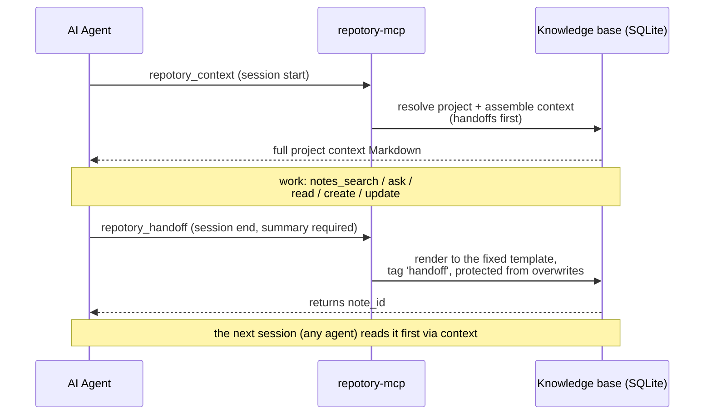

# AI Integration

Repotory provides read channels and self-check tools for AI agents, all reusing the same `internal/service` implementation (behavior identical to the desktop app).

## Value proposition: Repotory is a data source for AI, not an AI platform

**Repotory does not host models, does not hold API keys on your behalf, and ships no agent orchestration.** More precisely: it is the **data foundation** — it models raw git information into a structured, indexable, materializable local knowledge base (see [Storage Optimization and AI Value](../storage-optimization.md)); AI tools (Claude Code / Cursor, etc.) **consume** this layer of data through the 13 MCP tools, fetching on demand and searching precisely.

For the argument for why this layer is better than letting AI read git directly, see [Storage Optimization and AI Value](../storage-optimization.md).

A boundary that needs stating: earlier versions of this page claimed "**Repotory does not call any large language model**". **The product has since disproved that sentence** — AI Q&A (v1.15.0) calls an OpenAI-compatible `/chat/completions`, and optional semantic search calls `/v1/embeddings`. The accurate positioning is the sentence above: models and endpoints are **user-supplied**, the capabilities are **off by default**, and keys stay local. The distinction is worth being pedantic about because it decides where privacy responsibility lies — "we don't ship AI" means not one line of your notes leaves this machine unless you explicitly enabled it and typed in your own endpoint; "we ship AI" would not be that promise.

### Configuration keys

The whitelist in `internal/service/config.go` splits into two groups. **Core configuration has nothing to do with models or APIs**:

| Key | Type | Default | Purpose |
|-----|------|---------|---------|
| `auto_import` | 0 / 1 | **`0` (unreleased breaking change: existing databases are normalized to off)** | Whether startup auto-imports knowledge sources (today only `claude` is an automatic source; the other four are manual). **Only the value `1` enables it**: a missing row, an empty string, or junk all mean OFF. The old test was "not equal to `0`", and configuration reads map a missing row to an empty string — so **anyone who never configured it was defaulted in**, a real bug fixed here |
| `daily_code_standard` | integer | `500` | The daily code target (lines per day), used for the dashboard goal display. The name says "code standard" but it is not an AI standard — easy to misread |
| `scan_depth` | integer | `2` | Scan directory depth |
| `git_author` | string | System git user | Affects "My" statistics / heatmap attribution |

**The AI-side keys are all optional, all off by default, and all require you to supply the endpoint** — Repotory brings no service of its own:

| Key | Default | Purpose | What leaves the machine if enabled |
|-----|---------|---------|-----------------------------------|
| `claude_session_capture` | off | Allow reading Claude session transcripts on demand for handoff ([ADR-0010](../adr/0010-session-auto-capture.md)) | Nothing externally, but transcripts are read from disk |
| `openclaw_project` / `hermes_project` | empty | Target project for the two agent-global memory sources; unset means the whole source skips | Nothing |
| `semantic_search` + `embedding_base_url` / `embedding_model` / `embedding_api_key` / `embedding_dim` | off / empty | Vector recall covering FTS5's blind spots ([ADR-0012](../adr/0012-semantic-search.md)) | **Note text** → your embedding endpoint |
| `vector_store` + `vector_store_url` / `vector_store_api_key` / `vector_store_collection` | `local` | Where vectors live: local sqlite-vec, or remote Qdrant / Weaviate ([ADR-0013](../adr/0013-vector-database-selection.md)) | Vectors (not raw text) → your remote store |
| `ai_chat_base_url` / `ai_chat_model` / `ai_chat_api_key` | empty | AI Q&A on the project detail page | Your question + the packaged project context → your chat endpoint |
| `wiki_lint_llm` | off | Gates **only** the contradiction and stale-claim checks in lint; the other three are SQL and need no permission | Page excerpts → your chat endpoint (read-only analysis, writes nothing back) |
| `wiki_compile` | off | Ingest-time compilation: the **only switch that lets a model write into the knowledge base** | Note text → your chat endpoint; returned content is persisted locally, always as pending pages |
| `wiki_merge_suggest` | off | lets the chat model judge whether two pages are one concept ([ADR-0019](../adr/0019-entity-resolution-merge.md)); **requires `wiki_lint_llm` too**, and its only output is a todo — a human performs the merge itself | Both pages' titles + a bounded body excerpt of each (~700 bytes) → your chat endpoint |
| `wiki_community_summary` | off | lets the chat model draft `synthesis` pages (the fifth page kind, [ADR-0020](../adr/0020-community-synthesis.md)); **never scheduled**, and there is no MCP tool for it | Each member page's title + a bounded excerpt (≤900 bytes) → your chat endpoint |
| `community_min_size` | `3` | smallest community worth summarizing; fragments below it are dropped and counted as `dropped_small` | Nothing — a local-only threshold |
| `community_max_size` | `30` | largest community worth summarizing; bigger blobs are reported (as `dropped_large`) and not summarized | Nothing — a local-only threshold |
| `wiki_graph_search` | off | graph-aware evidence ([ADR-0018](../adr/0018-knowledge-graph-foundation.md) lane 2): AskAI's page evidence takes retrieval hits as seeds, expands 1 hop along `ref/part-of/documents` edges and re-ranks with PageRank; when off (the default), `evidencePages` keeps exactly the FTS order it had before | Nothing — a purely local SQL graph walk; if `semantic_search` is also on, page-vector recall inherits that endpoint's consent |

The three key-holding settings (`embedding_api_key`, `vector_store_api_key`, `ai_chat_api_key`) come back masked when configuration is read and are never sent to the UI — the backend holds the real value, the interface shows `********`.

## Semantic search and vector storage (optional)

Lexical search cannot answer "the same fact phrased differently"; vector recall covers that blind spot. The whole chain is off by default and **every failure degrades back to pure lexical results** — turning it on cannot return fewer hits ([ADR-0012](../adr/0012-semantic-search.md)).

- **Guided setup**: `go run ./cmd/vector-init`. It self-checks that sqlite-vec is loaded (create vec0 → write a test vector → KNN round trip → clean up), lets you pick an embedding provider (local Ollama is the default recommendation, or any OpenAI-compatible remote), writes the configuration, and finally points you at the in-app settings to review. Adding `-store qdrant` (or `weaviate`) writes a remote vector store and probes it immediately; **unreachable or unconfigured falls back to local automatically**, so search never gets worse.
- **The first run needs one full rebuild** (one text upload per note). After that, no more rebuilds: note creation, title/body edits and deletions are queued by database triggers and drained in the background every 5 seconds; vectors of deleted notes are removed from the index. When the dimension is unknown or the index does not exist yet, the drainer skips without consuming the queue (guessing a dimension risks dropping the whole index), and when the endpoint is unreachable the queue is kept and retried on the next tick. Details in [Knowledge Base and Notes](knowledge.md).
- **Measure before changing the default**: `go run ./cmd/abeval` runs "lexical vs lexical+vector" against a live database, reporting Recall@k / NDCG@k with a threshold gate. It reads your database but **does not modify it**: the tool runs against a throwaway `VACUUM INTO` copy, so any index rebuild or schema migration the evaluation triggers lands on the copy. Settings → AI exposes the opt-in switch and rebuild action, but until a real labelled query set passes that gate the feature stays off by default — an unproven feature is worse than a default-on one.

### Real-query labelling workflow (Phase 0 gate)

Default-on for semantic search and the ADR-0018 lane 2 graph-aware evidence gate share one **real labelled query set**. Five steps: tools do only the mechanical half, and **the relevance judgement is human-only**:

1. **Fill the corpus first**: labelling quality is bounded by what is in the library. Approve the pending pages on the review tab, then hit **Import Now** for each knowledge source in Settings → Plugins (the six sources are listed in [Knowledge import](../plugins/overview.md); sources whose `openclaw_project` / `hermes_project` is unset skip by design). Run `repotory_integrity` (MCP) to confirm no FTS index drift — **drift silently drops retrieval hits, and must be excluded before labelling**. Acceptance: **at least 10 notes** (target 15; below 10, a single query can dominate the outcome and the gate output is noise).
2. **Export the worksheet**: `go run ./cmd/queryset -seed > notes.tsv`. It reads a throwaway copy and writes nothing to your database; the printed line numbers are the only unit labelling uses.
3. **Label by hand**: each question must be one you would genuinely ask (real questions beat invented ones); fill `relevant=` with the 1–3 line numbers that actually answer it, **no padding**. This is the only fully manual step: the gate measures retrieval against the labels as ground truth, so ground truth guessed from notes by a tool would measure the guesser, not retrieval — **an unreviewed draft must never be used**.
4. **Emit the labelled set**: `go run ./cmd/queryset -emit notes.tsv -out queries.jsonl`. Number-to-id resolution is done by the tool (numbers are bound to their worksheet file — **never mix labelled lines from one worksheet into a freshly `-seed`ed file**, as numbering is re-assigned every run). **`queries.jsonl` is a long-lived asset, kept with the library**, shared by both gates.
5. **Run the gate**: `go run ./cmd/abeval -cases queries.jsonl -k 10 -min-recall 0.05`, printing Recall@k / NDCG@k and `GATE PASS/FAIL`. Also runs on a throwaway copy, never touching your database.

Gate thresholds: M3 default-on needs hybrid−lexical recall@10 gain ≥ 0.05; M7 Lane 2 graph-aware evidence needs a positive evidence+graph vs evidence delta, plus the `page#N` vs `note#N` mixing regression.

## AI Q&A: how it gathers evidence now

The floating-ball panel on the project detail page has an AI Q&A tab (since v1.15.1 it lives in the panel rather than the page header, sharing the shell and project selector with the logging tab).

Since M6-W2, direct mode **retrieves evidence** instead of pasting the head of the store:

- Two recall paths — **approved knowledge pages** (FTS5; see "Pending and approved" in [Knowledge Base and Notes](knowledge.md)) and **notes** (the existing search path, which includes vector recall once semantic search is enabled) — interleaved by rank position.
- Rendered as a numbered `[P#]` / `[N#]` evidence block under a triple budget of item count, character quota and timeout. The panel lists what it used, how much the budget dropped, and says so explicitly when nothing was retrieved at all.
- Below the answer, **File as page** keeps a good answer in the store: the links it creates come only from refs the answer actually cites (an invented ref resolves to nothing), which is also the query loop ADR-0014 promises.
- When retrieval finds nothing, it **falls back to the previous static pack** (project base plus those ten notes), so the answer never gets less context than before. Note those ten are the **oldest** by `created_at`, not the newest.

Answers are now **streamed** (since M6-W3 the desktop path uses `StartAskStream` + Wails events, the browser mode uses SSE on `/api/ai/ask-stream`, rendered token by token with cancellation). Limits that still hold, so do not read this as finished: **no tool calls**; pages have no vector index of their own (fusion is notes-only, see ADR-0012/0013), so page recall is lexical and title-weighted; and the evidence quality was measured only on a constructed corpus (Recall@8 / NDCG@8 clearly beat static packing) — **the gain on real libraries is still unmeasured**, which needs a labelled query set.

If nothing must leave the machine, use **Copy AI context**: it puts the packaged prompt on the clipboard and you decide where it goes; no endpoint is called.

A model writing into the knowledge base at all (compilation) requires two further conditions together: `wiki_compile=1` and a configured AI endpoint. Its output is always pending, and unapproved pages never reach retrieval — see [Knowledge Base and Notes](knowledge.md).

## Headless HTTP service and the executable inventory

Beyond MCP there is a second channel onto the same implementation: expose `internal/service` over loopback HTTP for browser mode, scripts and other agents.

```
go build -o repotory-server ./cmd/server
./repotory-server --port 18765        # or env REPOTORY_HTTP_PORT; listens on 127.0.0.1 only
```

- `POST /api/rpc` reflects every desktop binding (JSON body naming method + args) and runs the **same implementation** as Wails; `Startup` / `Shutdown` / `Service` itself are excluded. Write operations obey the same protocol protections as MCP (for example handoff notes refuse to be overwritten by update).
- For browser development use `bash scripts/dev.sh`: it starts the headless API (default 18765) *and* Vite. Running `npx vite` alone yields a page that loads but 502s every request — that is a missing backend, not a broken app.
- **Release assets contain only**: the desktop installers (4 platforms), `repotory-mcp-<platform>`, and the VS Code VSIX. `repotory-server`, `cmd/vector-init`, `cmd/abeval`, `cmd/repotory-capture` and `cmd/wiki-export` (the read-only wiki export) must be built yourself (`go build` / `go run`); they are not distributed with releases.

MCP is the only AI execution interface (the `repotory` CLI is not shipped with releases). stdio protocol, the database is opened once per process, 13 tools (including 4 write operations: scan + note create/update + session handoff):

The two ends of the session memory protocol, in sequence:



How to read it: the protocol has exactly **two entry calls** (`repotory_context` to open a session, `repotory_handoff` to close it) and one guarantee in between — a handoff note is written once, tagged `handoff`, and `repotory_notes_update` refuses to overwrite it, so the next session always reads the same record at the top of its context.

| Tool | Description | Read/Write |
|------|-------------|------------|
| `repotory_scan` | Cold start: seeds the default scan roots and scans them synchronously, discovering local Git repositories (works with a pure MCP install, no desktop app needed) | Write |
| `repotory_context` | Injects the full project context at session start (tech stack / README / todos / highly relevant notes, with handoff notes pinned to the top). Optional `path` (an absolute directory / cwd) resolves the owning project — see "Workspace path resolution" | Read |
| `repotory_handoff` | Structured handoff at session end (summary/changes/decisions/gotchas/next_steps), persisted to the database and read back pinned-to-top by the next `repotory_context`; notes written this way carry a `handoff` tag, and `repotory_notes_update` refuses to overwrite them. `project_id` is optional and resolved from `path` when omitted | Write |
| `repotory_notes_list` | All notes | Read |
| `repotory_notes_search` | FTS5 search (query). Optional `path`: notes recorded inside the matched repository rank first — ranking only, nothing filtered | Read |
| `repotory_notes_read` | Read a note by ID | Read |
| `repotory_notes_create` | Create a new knowledge note | Write |
| `repotory_notes_update` | Update note content and metadata (partial update; refuses to overwrite `handoff` protocol notes) | Write |
| `repotory_projects_list` | All projects | Read |
| `repotory_projects_stats` | Project statistics (by id) | Read |
| `repotory_ask` | Q&A-style retrieval, top-5 text results | Read |
| `repotory_agent_score` | Check local AI readiness (DB / notes / search / MCP / llms.txt / SKILL.md / i18n) | Read |
| `repotory_integrity` | Audit data trustworthiness (FTS index drift / orphan rows / cache freshness / coverage) | Read |

### Readiness vs. data trustworthiness

The two self-check tools answer **different questions** — don't mix them up:

| Tool | Question it answers | Question it cannot answer |
|------|--------------------|---------------------------|
| `repotory_agent_score` | Is this installation configured correctly? (notes present? MCP reachable? i18n complete?) | Whether the data itself is correct |
| `repotory_integrity` | Can the data still be trusted? (has the index drifted? are there orphan rows? is the cache fresh?) | Whether the configuration is complete |

**Why the second one exists**: once the FTS5 index drifts out of sync with `project_notes`, search **silently returns fewer results**, while `agent_score` still reports "Search operational" — it measures connectivity, not content. `repotory_integrity` compares the index's real document count against the FTS5 `_docsize` shadow table (with an external-content table, a plain `SELECT rowid` reads the content table, so it would never reveal the drift) and checks that the sync triggers are all in place. For details, see the [checklist in `internal/integrity`](../../../internal/integrity/integrity.go).

When an AI notices that "the search results seem incomplete", it should run `repotory_integrity` first instead of jumping to the conclusion that the knowledge base has little content.

### Workspace path resolution: which project owns this folder

"Which project is the directory I'm standing in?" was the most common question that used to be unanswerable. The old `ResolveProject` matched with `strings.Contains(project.RootPath, query)` — the stored root had to *contain* the query — so a subdirectory of a multi-repository project (e.g. `/…/CBiPay/pay-common`) never matched, and the `repositories` table, which does record that directory, was never consulted at all. The VS Code extension additionally never sent the workspace path anywhere, and the handoff command refused to run until you had hand-typed a numeric project id.

`Service.ResolveProjectByPath` now does a **four-tier path resolution**, most specific first:

1. a repository stored at exactly the directory → its project (scope = that repository)
2. the deepest repository path that is an *ancestor* of the directory → its project
3. a project whose `root_path` equals the directory → that project
4. the deepest project `root_path` that is an ancestor → that project

The repository tiers (1, 2) beat the project tiers (3, 4) because a repository match names the *module*, not just the container.

**The container restriction (tier 4 only).** Projects with `is_auto_grouped = 1` are scan-time catch-all containers and **may not win by ancestry** — this database genuinely contains one rooted at the user's home directory, so an unrestricted ancestor match would claim every folder under home for it and inject the wrong project's knowledge with no signal, which is strictly worse than "unresolved, pick one". An auto-grouped project may still match **exactly** via tier 3 (deliberately opening that folder is a real answer). Callers can lift the restriction explicitly.

**Matching is reported, not assumed.** Every result carries `MatchedOn`: `repository-exact` / `repository-ancestor` / `project-exact` / `project-ancestor` / `repository-…-orphan` / `unresolved` (a case-folded hit appends `-case-folded`, and a repository tier combined with a project tier reads `repository-X+project-Y`). When nothing resolves, the caller gets the project catalog plus `unresolved` — never a silent guess. A repository whose project row is gone is reported as an orphan rather than as a resolution, because "this folder is a scanned repo whose project was deleted" is a different, actionable diagnosis from "never seen this folder".

**Path semantics.** An ancestor test is segment-aware, never `strings.HasPrefix` (`/a/b` is a string prefix of `/a/bc` but is not its parent directory). Longest/deepest path wins among siblings. Case folding is a **fallback only** — an exact case-sensitive match always wins, because on a case-sensitive filesystem two paths differing only in case are different directories.

**Repository scoping, by rank not by filter.** `note_repositories` existed since the wiki layer's first migration but had **zero writers in the entire codebase**, so any strict "filter notes to this repository" would have returned nothing for every existing project. Two consequences:
- The handoff path now *writes* the attribution: `HandoffInput.WorkspacePath` resolves to a repository and attaches the note to it. Attribution refuses to cross projects (a repository belonging to a different project than the handoff names is not attached), and an attribution failure never fails the handoff — it is reported in `HandoffResult.RepositoryNote` while the note itself is kept.
- Consumers **reorder rather than remove**: in `repotory_context` output, notes recorded inside the matched repository lead and the remaining project notes still appear, preceded by an explicit `_Scope: repository "x" (matched by …)_` line that says so honestly when nothing is attributed yet ("the N project notes below are unfiltered"). `repotory_notes_search` ranks the same way and leaves todos untouched, because the attribution table describes notes.

**Mining no longer answers with an arbitrary sibling.** `GetProjectOverview` keyed its cache by `repos[0].ID` and mined at the project root, so for a container of sibling repositories the tech stack / README / commits shown were whichever repository sorted first. `GetRepositoryOverview(projectID, repositoryID)` narrows mining, cache and commits to that repository (which also gives mining a real git root — the v13 case migration could only invalidate). A repository id that does not belong to the project is **refused**, not substituted.

This resolution lives **server-side** and is shared by the MCP tools and the VS Code extension: `repotory_context` / `repotory_handoff` / `repotory_notes_search` gained an optional `path`, and the extension reads its scope display from the new read-only `ResolveWorkspacePath` binding, so the client never reimplements the matcher. Note that in `repotory_context` a `path` that resolves to a project takes precedence over `project_id`/`project_name`, whereas in `repotory_handoff` `project_id` wins and `path` is only the fallback when it is absent. (The tool's own MCP description still calls `project_id` "preferred"; for `repotory_context` the resolving path actually wins — a known mismatch between the description string and `ResolveWorkspace`.)

### One-command registration (repotory-init, recommended)

Step one of [ADR-0009](../adr/0009-ide-presence.md): detect the binary and register every supported client with a single command; idempotent and safe to re-run:

```bash
node scripts/repotory-init/index.mjs --with-hook
```

**It runs in any project**: the extension's `Repotory: Register MCP Server` command uses the copy of `repotory-init` bundled inside the VSIX (the source of truth stays at `scripts/repotory-init/index.mjs`, copied in by `compile` and pinned to it by a CI `git diff --exit-code`), so cloning this repository first is not required. The bare command above does require you to be inside this repository.

- Detects `repotory-mcp` (override with `--bin`) and registers it with Claude Code (`.mcp.json`), Cursor (`.cursor/mcp.json`), VS Code (`.vscode/mcp.json`) and Windsurf (configs land only where the client's directory exists); JetBrains gets printed manual guidance
- `--with-hook` also installs the SessionEnd hook below (script + merged `settings.json`, backed up before changes)
- `--dry-run` previews every write; when the binary is missing it prints install guidance, and `--yes` writes the bare command name `repotory-mcp` (works once installed)

### Connect Claude Code manually (alternative)

```bash
claude mcp add repotory -- /path/to/repotory-mcp
```

Or write it into `.mcp.json` (project level) / `~/.claude.json` (user level):

```json
{
  "mcpServers": {
    "repotory": { "command": "/usr/local/bin/repotory-mcp", "args": [] }
  }
}
```

### Automatic handoff at session end (SessionEnd hook)

The real meaning of "zero-cost capture" is not "the agent remembers to call it on its own" — relying on goodwill is the same as making no promise. Claude Code's **SessionEnd hook** turns the handoff into part of the session lifecycle: the moment a session ends, the handoff happens, no matter how good the agent's memory is. This is also the path that lets a new user feel "the next session starts with full context" on day one.

Write it into `.claude/settings.json` (project level, shared with collaborators through the repository):

```json
{
  "hooks": {
    "SessionEnd": [
      {
        "hooks": [
          {
            "type": "command",
            "command": "\"$CLAUDE_PROJECT_DIR\"/.claude/hooks/repotory-handoff.sh"
          }
        ]
      }
    ]
  }
}
```

The companion script `.claude/hooks/repotory-handoff.sh` (remember to `chmod +x`):

```sh
#!/bin/sh
# SessionEnd hook: make the handoff automatic instead of relying on the
# agent's goodwill. One bounded headless turn costs a fraction of the
# session it preserves; "the agent will remember to call handoff" costs
# the entire exit record whenever it forgets.
set -u
cd "${CLAUDE_PROJECT_DIR:-$(pwd)}" || exit 0
command -v claude >/dev/null 2>&1 || exit 0
claude -p --mcp-config .mcp.json \
  'This session ended. Call repotory_handoff for the current project: a concise summary plus next_steps. If the project cannot be resolved, call repotory_context once first. Do nothing else.' \
  >/dev/null 2>&1 || true
```

Design points and costs (stated plainly, so the narrative doesn't oversell):

- **Trigger**: fired by Claude Code when a session ends; the trigger reason (`clear` / `logout` / `prompt_input_exit` / `other`) is written to stdin as JSON, and the script can read stdin and skip when appropriate (e.g. "the context was just cleared" doesn't need a handoff).
- **Cost**: one bounded headless turn (`claude -p`), a fraction of the whole session context it preserves; the hook has a default timeout (60s) and the script ends silently with `|| true`, so the session exit is never blocked.
- **Fallback path**: skipped outright when the `claude` CLI is missing; when MCP is not registered, the headless call fails and is swallowed — the protocol requires handoffs to be written through `repotory_handoff`; the hook only guarantees "it always fires" and never bypasses the protocol to write the database directly.
- **Protocol protection**: handoff notes carry the `handoff` tag and `repotory_notes_update` refuses to overwrite them (guarding against accidental clobbering); in the next session, `repotory_context` renders them in full, pinned to the top.
- The hook's event name and configuration fields evolve with Claude Code versions; before wiring it up, defer to `claude --help` and the official hooks documentation.

### Connect Cursor / other MCP clients

Add the same `command` pointing at the `repotory-mcp` binary in the client's MCP configuration (Cursor: `Settings → MCP → Add Server`).

## llms.txt and Markdown export (in-app)

- **llms.txt**: `GenerateLLMsTxt` generates a knowledge base overview in Markdown (project directory + tech stack + the 20 most recent knowledge notes), suitable for feeding an LLM to establish context. **llms.txt is an export format** (generated in-app, not shipped with the repository) and is not being expanded into a standalone product direction (see ADR-0006)
- **Note export**: any note can be exported as `.md` with YAML frontmatter (`ExportNoteAsMarkdown`)
- **Claude memory import**: idempotent import from `~/.claude/projects/*/memory/*.md` (see [Knowledge Base](knowledge.md))

## agent-score self-check

agent-score has been merged into the MCP tool `repotory_agent_score`; no separate build is needed. Call it from any MCP client to get the 7-item AI readiness score.

## Why not just let AI read the git repository

A common question: since Claude Code / Cursor can run `git log` and read files directly, why route through Repotory at all? The core answer is **cost and determinism**:

- **Reading is expensive**: every direct `git log` or file-by-file scan is a one-off expense — repeated reads mean repeated tokens;
- **Reading is messy / incomplete**: large repositories inevitably exceed the context window and get truncated, and the model may hallucinate or skip binary files / `.gitignore`;
- **Reading is slow**: recomputing statistics on every call turns a seconds-scale task into a minutes-scale one.

Repotory parses and materializes the raw git data into local SQLite **once at scan time** (`daily_stats` pre-aggregates statistics, `repo_meta` caches mined results, `project_notes_fts` builds the full-text index); after that, AI only fetches on demand and hits precisely through the MCP tools. For the full comparison and storage structure details, see [Storage Optimization and AI Value](../storage-optimization.md).

## Skill card for AI agents

[SKILL.md](https://github.com/sky-jiangcheng/repotory/blob/master/SKILL.md) at the repository root is a capability card written for agents to read (commands, tool table, paths) — feed it to them directly.
