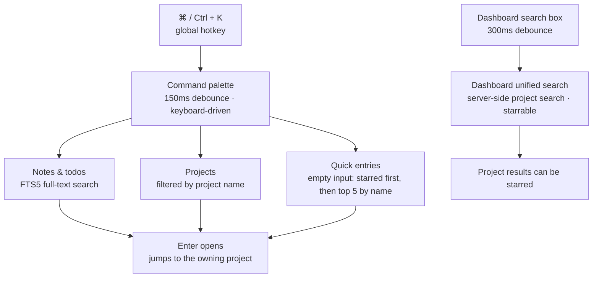

# Command Palette and Keyboard Shortcuts

How to read it: **the two entries are two independent implementations, not one palette** — the ⌘K command palette is keyboard-driven (150ms debounce, projects filtered locally by name, `↑` `↓` + `aria-activedescendant` navigation, focus trap); the dashboard unified search is mouse-driven (300ms debounce, projects searched server-side, results starrable, collapses on outside click). What they share is only the same FTS5 notes/todos search backend. The three branches (notes / projects / quick entries) all fall back to the same action (open on Enter).

## Keyboard Shortcuts

| Shortcut | Action | Notes |
|----------|--------|-------|
| `⌘/Ctrl + K` | Open / close the command palette | Works globally |
| `↑` / `↓` | Move the selection | Navigate within the palette |
| `↵ Enter` | Open the selected item | Jump to the corresponding project |
| `Esc` | Close the palette | Focus returns to the trigger element |

> Also: pressing `/` inside the editor opens the block panel (see [Knowledge Base](knowledge.md)); deleting a todo or a note always requires a two-click confirmation.

## Command Palette

Open with `⌘/Ctrl + K`; a single input box merges three kinds of results:

- **Notes and todos**: FTS5 full-text search (title / content / todo titles); Enter jumps to the owning project
- **Projects**: filtered by project name; Enter opens the project details
- **Quick access**: with an empty input, the first 5 projects are shown (starred first, the rest by name)

Accessibility: implemented as an ARIA combobox-in-dialog with a focus trap and focus restore on close; `aria-activedescendant` drives keyboard selection.

## Dashboard Unified Search

The dashboard search box is an independent component (not the same panel as the command palette), with these differences:

- Projects are searched server-side (name / path match), not filtered locally
- Live search with a 300ms debounce (the command palette uses 150ms)
- Star / unstar repositories directly from the results
- Collapses automatically on outside click

Notes and todos search, meanwhile, is **the same backend capability in three frontends** together with the command palette and the [knowledge base](knowledge.md) page: all three hit the same full-text index (trigram + bm25), so results are identical, and all three are local-only search. AI Q&A is not in any search box — it lives in the floating capture ball as a project-scoped ask panel.
