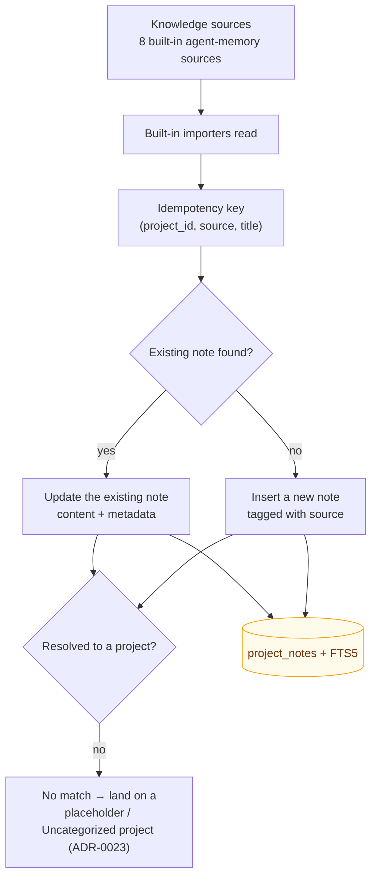

# Knowledge Source Import

> **Note**: knowledge-source import is not open to user scripts — the in-process script-plugin runtime (yaegi, [ADR-0002](../adr/0002-c-end-repositioning.md)) was removed in C11. The source list is entirely built in and only grows with releases.

Repotory imports documents into the knowledge base idempotently. All eight sources ship **built in** as ordinary Go implementations of `plugin.KnowledgeImporter`; the in-process script-plugin runtime (yaegi) was removed in C11, so there is no user-authored importer entry point.

How to read it: all sources **converge on one upsert path**, and idempotency is guaranteed by the triple `(project_id, source, title)`. Re-importing therefore **updates** rather than creating duplicates — running the import again never makes the knowledge base dirtier. Writes go through a trigger that syncs the FTS index, so imported documents are immediately searchable via `repotory_notes_search`.

The last branch no longer drops documents as of ADR-0023: a document that matches no project is landed on a **landing project** — when the source carries a real repo path, a "Unfiled repo" placeholder is created or reused by repo name (it is promoted to a real project once a scan later discovers that same repo); global-memory sources with no repo path (`openclaw` / `hermes` / `codebuddy-memory`) land on the always-present **Uncategorized** default project. Knowledge is no longer silently lost; you can then re-file these notes into a real project from the knowledge base's **Organize** view.

## Built-in knowledge sources

| Source | Trigger | Reads | Notes |
|--------|---------|-------|-------|
| `claude` | **automatic** | `~/.claude/projects/*/memory/*.md` | skips `MEMORY.md`; skips files over 100 KB |
| `codex` | manual | `~/.codex/sessions/**/rollout-*.jsonl`, `~/.codex/archived_sessions/**` | first user instruction + last assistant reply per session |
| `opencode` | manual | `$XDG_DATA_HOME` / `~/.local/share/opencode/storage/session/**/*.json` | session title + summary |
| `openclaw` | manual | `~/.openclaw-autoclaw/workspace/*.md` | single level, never recursive; target project **optional** (falls to Uncategorized) |
| `hermes` | manual | `$HERMES_HOME` / `~/.hermes/memories/{MEMORY,USER}.md` + `state.db` (`messages` table, read-only) | memory notes + session logs; target project **optional** (falls to Uncategorized); an unrecognized layout fails the **whole source** |
| `cursor` | manual | `<config>/Cursor/User/globalStorage/state.vscdb` (override with `CURSOR_STATE_DB`) | read-only; first prompt + last reply; an unrecognized layout **fails the whole source** |
| `codebuddy` | manual | `~/Library/Application Support/CodeBuddyExtension/Data/<uid>/<IDE>/history/*/index.json` + `messages/*.json` | session transcripts; first prompt + last reply; a corrupt single file drops only that session |
| `codebuddy-memory` | manual | `~/.codebuddy/memery/*.md` + `Public/.memories/*.mdc` | user memory profile + write-rule memory; target project **optional** (falls to Uncategorized) |

"Automatic" means the source runs at startup together with `auto_import` (**off by default**; enable it explicitly in **Settings → Plugins**). "Manual" means it only runs when you click that source in **Settings → Plugins** — those are raw session transcripts, large and noisy, which is why they never belong in a startup rescan.

### Project ownership

Five of the sources carry a project hint of their own (Claude's `-Users-x-Work-Foo` directory name, the session's `cwd`, OpenCode's `directory`, Cursor's `workspaceId → workspaceStorage/<id>/workspace.json` folder path, and CodeBuddy's `Workspace Folder:` line in the first user message). The **last path segment** is matched with a three-step rule: exact project name → repository path ending with that segment → project name containing it. As of ADR-0023 a non-match is **no longer counted as skipped**: the document lands on a "Unfiled repo" placeholder created by repo name, keyed on the source repo path (a later scan of that repo promotes it to a real project; Claude uses a mangled directory name that may not equal the real path, so its placeholder does not auto-promote and needs manual re-filing in the Organize view).

`openclaw`, `hermes` and `codebuddy-memory` files contain no project hint at all, so their target project comes from configuration:

| Config key | Purpose |
|------------|---------|
| `openclaw_project` | project name or project ID that openclaw notes attach to |
| `hermes_project` | project name or project ID that hermes notes attach to |
| `codebuddy_project` | project name or project ID that codebuddy-memory notes attach to |

> As of ADR-0023 the config key is **optional**: set it and all notes from these three sources attach to the named project; **with no value they no longer skip silently** (the old behaviour) but land on the Uncategorized default project, from which you can re-file them manually in the Organize view. An import therefore never "creates zero notes" again.

### Import statistics

Each run returns `{created, updated, skipped}`:

- `created` — notes inserted
- `updated` — notes hit by the idempotency key and refreshed (a re-import puts everything here)
- `skipped` — documents **not written because they were oversized or unparseable**. Note: as of ADR-0023, "matched no project" is **no longer counted here** (those notes land on a placeholder / Uncategorized project)

So "importing twice yields `updated=6, created=0`" is the proof idempotency worked, not evidence that nothing happened.

Startup auto-import is toggled in **Settings → Plugins** (the `auto_import` config item, **off by default**: reading another tool's memory files and writing them into this database is privacy-relevant, so it requires an explicit opt-in; upgrading normalizes a legacy "on" to "off" — see CHANGELOG). Manual triggering is available on the same page.

### Headless mode

`cmd/server` (the standalone API service started with `--port`) runs the same startup sequence as the desktop app, so source registration and `auto_import` behave identically: `GetKnowledgeSources`, `TriggerKnowledgeImport` and `TriggerAllKnowledgeImports` all work through `/api/rpc`.

## Idempotent import semantics

The runtime upserts on `(project_id, source, title)`: importing the same content again **updates** the existing note instead of creating a duplicate.
