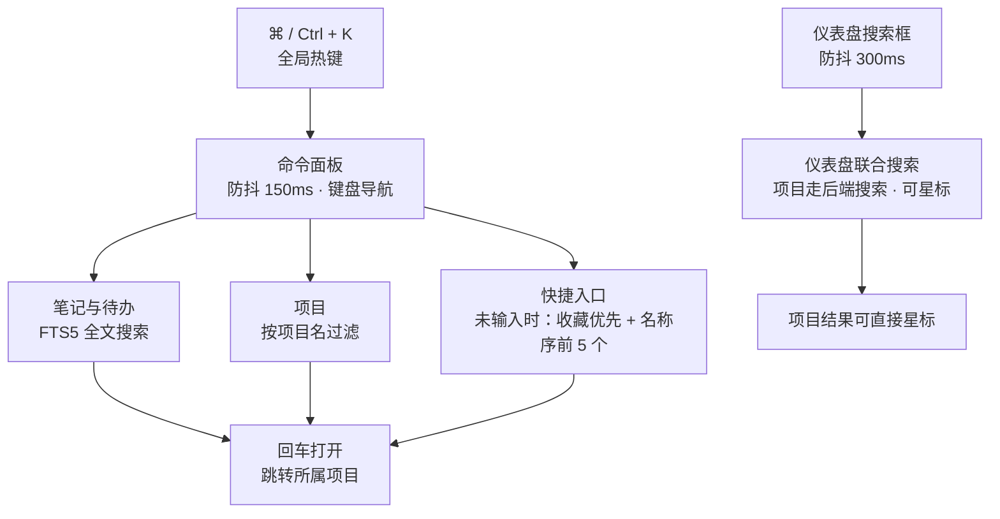

# 命令面板与快捷键

读图：**两个入口是两套独立实现，不是同一个面板**——⌘K 命令面板键盘驱动（150ms 防抖、项目按名称本地过滤、`↑` `↓` + `aria-activedescendant` 导航、焦点陷阱）；仪表盘联合搜索鼠标驱动（300ms 防抖、项目走后端搜索、结果可星标、点击外部收起）。两者共用的只是同一份 FTS5 笔记 / 待办检索后端。三条分支（笔记 / 项目 / 快捷入口）都回到同一个动作（回车打开）。

## 快捷键

| 快捷键 | 功能 | 说明 |
|--------|------|------|
| `⌘/Ctrl + K` | 打开 / 关闭命令面板 | 全局生效 |
| `↑` / `↓` | 移动选中项 | 面板内导航 |
| `↵ Enter` | 打开选中项 | 跳转到对应项目 |
| `Esc` | 关闭面板 | 焦点返回触发元素 |

> 此外：编辑器内 `/` 呼起块面板（见[知识库](knowledge.md)）；待办与笔记删除均为两击确认。

## 命令面板

`⌘/Ctrl + K` 打开，一个输入框联合三类结果：

- **笔记与待办**：FTS5 全文搜索（标题 / 内容 / 待办标题），回车跳转所属项目
- **项目**：按项目名过滤，回车进入项目详情
- **快捷入口**：未输入时展示项目列表前 5 个（收藏优先，其余按名称排序）

无障碍实现：ARIA combobox-in-dialog，焦点陷阱 + 关闭后焦点返还，`aria-activedescendant` 驱动键盘选中。

## 仪表盘联合搜索

仪表盘搜索框是独立组件（与命令面板不是同一个面板），能力差异：

- 项目走后端搜索（名称 / 路径匹配），不是本地过滤
- 300ms 防抖实时搜索（命令面板为 150ms）
- 项目结果中直接星标 / 取消星标
- 点击外部自动收起

笔记与待办检索则与命令面板、[知识库](knowledge.md)页面是**同一后端能力的三处前端**：都走同一个全文索引（trigram + bm25），结果一致，三处都只做本地检索。AI 问答不在任何搜索框里，而是悬浮收录球内的项目级问答面板。
