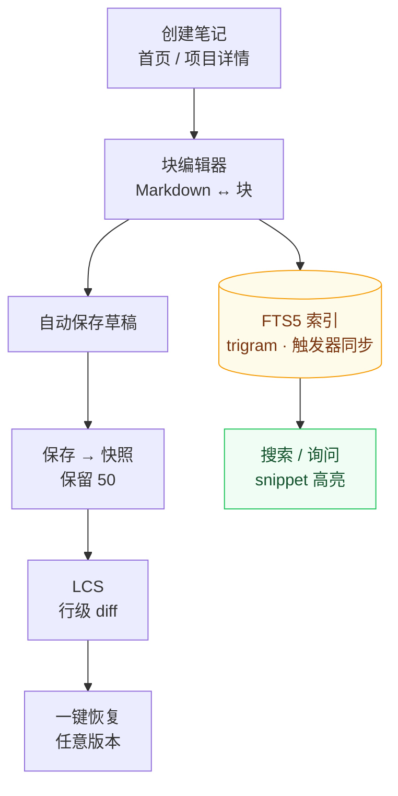

# 知识库与笔记

知识库是应用首页，也是跨项目的笔记中心：Markdown / 块编辑器、标签分类、FTS5 全文搜索、版本历史与 AI 记忆导入。



读图：一条**主干（编辑→保存→快照→diff→恢复）+ 一条旁路（索引→搜索）**。主干解决“知识不能丢”，旁路解决“知识能被找到”——两者都由保存动作同时触发（快照走写入触发器，索引走 FTS 同步触发器），因此不需要用户记得点任何“保存”按钮。点击笔记卡片的 **历史** 按钮进入版本侧，搜索框进入旁路侧。

## 笔记管理

- **创建笔记**：首页「快速创建笔记」选择所属项目；或项目详情页笔记面板新建
- **元数据**：标题（留空取首行）、标签（逗号分隔）、分类（知识 / 日志 / 想法 / 其他）、置顶
- **跨项目迁移**：编辑状态下「关联项目」下拉一键迁移
- **草稿自动保存**：编辑内容实时存入本地，意外关闭不丢失

## 块编辑器

输入 `/` 呼起块面板，插入结构化块：

| 块 | 说明 |
|----|------|
| Callout | TIP / WARNING / NOTE 提示块 |
| 代码块 | 带语言高亮 |
| Mermaid 图 | 流程图 / 时序图等 |
| 数学公式 | KaTeX 渲染 |
| 待办列表 / 表格 / 分隔线 | 常用结构 |
| 折叠块 / Tabs | `<details>` 与 `` |

- 块可拖拽排序、上下移动、独立删除
- **Markdown ↔ 块双轨随时切换**：存储格式始终是纯 Markdown，任何编辑器都能打开

## 富渲染

highlight.js 代码高亮、Mermaid 图、KaTeX 数学公式、GFM Callout 与任务列表。

## 搜索

- 首页搜索框自动聚焦；「询问知识库」模式返回带相关性的答案片段
- FTS5 trigram + bm25 排序，snippet 高亮匹配词；短 CJK 查询自动降级 LIKE
- 覆盖笔记与待办；`⌘/Ctrl+K` 命令面板随时可用

### 语义检索（可选，默认关）

词法搜索回答「哪些字面命中」，答不了「同一件事的另一种说法」。可选的向量召回补的是这个盲区：

- **两级检索融合**：FTS5 与向量召回经 RRF（k=60）合并，向量只做**补充**——任何一步失败（端点未配、请求报错、索引不存在）都退回纯词法结果，**开启它不会让搜索结果变少**。这是设计约束不是安慰话：语义检索的第一版就是靠这条约束才敢默认关着上线。
- **默认关**：仅当 `semantic_search=1` **且**配好 embedding 端点（`embedding_base_url` + `embedding_model`）时才生效。设置页目前不提供这些开关，需按 [AI 集成](ai-integration.md) 的「语义检索与向量存储」一节用配置键开启。
- **首次要跑一次全量重建**：把每条笔记的文本送去 embed，成本是 O(全部笔记) 的端点遍历。它会顺带把探测到的向量维度持久化下来。
- **之后不需要再重建**：笔记的新建、改标题/正文、删除由 SQLite 触发器排队，后台每 5 秒批量排空——还在的笔记重新 embed，已删除的从向量索引里移除（否则你删掉的文本会一直出现在召回结果里）。三条保守行为：置顶 / 改标签 / 移动项目**不**触发 embed（它们不改变送进端点的文本）；端点不可用时任务原地排队、下一轮重试，所以离线不会丢写；维度未知或索引还没建时直接跳过，不猜。
- **导入的笔记同样自动进索引**：排队由数据库触发器负责，而所有写入者（界面、MCP、CLI、agent 记忆导入）都收敛到同一层——这也是为什么它没做在应用逻辑里。
- **隐私边界**：开启语义检索意味着笔记文本会发往你配置的 embedding 端点（本地 Ollama 或远端 API，取决于 `embedding_base_url`）。这是显式选择，默认关着；`embedding_api_key` 与 `vector_store_api_key` 是密钥，读取配置时以掩码返回、不回传给界面。
- **向量索引是派生缓存**，笔记本体才是事实源：随时可以 drop 并从笔记重算，与笔记同库同事务同备份（零 CGO 的纯 Go sqlite-vec）。确有大规模需求才需要远程向量库，见 [AI 集成](ai-integration.md) 的「语义检索与向量存储」一节。
- **效果不好可以量化验证**：`cmd/abeval` 对活库跑「词法 vs 词法+向量」的 Recall@k / NDCG@k 并给出门槛判定（同样在一次性副本上运行，不写你的库）。刻意先有门再有开关——没有真实标注 query 集之前，前端不放这个开关。

## 版本历史

每次保存自动创建快照（保留最近 50 个）。笔记卡片 **历史** 按钮：

- 版本列表（时间、标题）
- 查看任意版本与当前的行级 LCS diff（+/- 标记）
- 一键恢复到任意历史版本

## 从 agent 记忆导入知识库

应用内置 8 个知识源，把你在各 agent 工具里留下的记忆/会话转录幂等导入为知识笔记（重复导入更新而非重复创建）：

| 源 | 触发 | 读什么 |
|----|------|--------|
| `claude` | 启动自动 | `~/.claude/projects/*/memory/*.md` |
| `codex` | 手动 | 会话转录 `rollout-*.jsonl`（首条指令 + 末条回复） |
| `opencode` | 手动 | 会话标题与摘要 |
| `openclaw` | 手动 | `~/.openclaw-autoclaw/workspace/*.md` |
| `hermes` | 手动 | `~/.hermes/memories/{MEMORY,USER}.md` |
| `cursor` | 手动 | Cursor `globalStorage/state.vscdb` 的会话（best-effort，见下） |
| `codebuddy` | 手动 | CodeBuddy 会话转录（首条指令 + 末条回复） |
| `codebuddy-memory` | 手动 | `~/.codebuddy/memery/*.md` + `Public/.memories/*.mdc` |

**设置 → 插件** 可查看全部导入源、逐个手动触发，并看到每个源的 `{created, updated, skipped}` 统计。

三条容易踩的规则：

1. **导入按项目归属，不是全堆进知识库首页。** 文档靠项目名 / 仓库路径匹配到具体项目，匹配不上的计入 `skipped` 而不入库。所以先扫描入库项目、再导入，命中率才高。
2. **`openclaw`、`hermes` 与 `codebuddy-memory` 需先配置目标项目**（`openclaw_project` / `hermes_project` / `codebuddy_project`），否则静默全部 `skipped`。
3. **重复导入不是失败。** `created=0` + `updated=N` 说明幂等命中，内容已更新。

**`cursor` 是唯一标 best-effort 的源**：Cursor 的落盘格式未公开且带版本位，所以它只取每场会话的**首条提问 + 末条回复**（不复制整段转录），归属靠 `workspaceStorage/<id>/workspace.json` 的 folder 反查项目——查不到就跳过，绝不猜；而一旦库表结构不是它认识的形状，**整个源直接报错而不是安静导入 0 条**（"没导入"和"你没会话"必须可区分）。读取全程 `mode=ro`，绝不写别人的库。

导入的笔记 `kind` 为 `knowledge`（记忆类）或 `log`（会话类），写入后立即可被全文搜索命中；开启语义检索后也会被向量召回取到，且**不需要再跑一次重建**（排队由触发器负责，见「语义检索」）。各源的完整路径、匹配规则与限制见 [知识源导入](../plugins/overview.md)。

## 知识页面与审核队列

笔记是**原始记录**，页面是**编译产物**。同一个事实可以先记在笔记里（谁在什么时候怎么处理的），再由它长出概念页/实体页，页面之间用有向链接连成图——这是 `project_notes` 本身给不了的形状：笔记只挂项目、互相之间没有任何引用。

| 页面类型 | 装什么 |
|---------|--------|
| `entity` | 一个具体东西（模块、服务、仓库、人物） |
| `concept` | 一个概念（幂等键、会话超时、扫描深度语义） |
| `source` | 某一份来源材料的摘要页 |
| `synthesis` | 跨来源的综述与结论 |
| `query` | 一次好问答的回档（见 [AI 集成](ai-integration.md) 的"存为页面"） |

页面层是**派生缓存**：笔记才是事实源，整层可以随时丢掉重建（`DropWikiSchema`），且丢完重启会自动长回来。

### 页面之间的边：受控关系词表（schema v21）

页面靠**有向链接**连成图，而每条链接都带一个**关系类型**。早期类型是自由文本（编译器写 `compiled-from`、回档问答写 `cites`、模型爱写什么写什么），于是"这张图里所有依赖关系有哪些"根本问不出来。v21（[ADR-0018](../adr/0018-knowledge-graph-foundation.md) 的第一半）把它收成八个枚举值，数据库层用 `CHECK` 硬约束：

| 关系 | 含义 |
|------|------|
| `ref` | 一般引用（默认；拿不准就用它） |
| `part-of` | 组成：A 是 B 的一部分 |
| `depends` | 依赖：A 依赖 B |
| `implements` | 实现：A 实现了 B 这个概念/接口 |
| `documents` | 描述：A 是对 B 的说明 |
| `supersedes` | 取代：A 取代更旧的 B |
| `contradicts` | 冲突：A 与 B 相互矛盾 |
| `mentions` | 提及：A 的正文里点了 B |

边从三个地方长出来：**编译器**按上面词表选词建 `pending` 边；**回档问答**把答案页指向它引用的证据页（`ref`）；以及你在**批准一个页面时**，系统会把它正文里的 `[[wikilink]]` 自动解析成 `mentions` 边——只连到真实存在的页，指向不存在的页仍算"悬空链接"交给 lint，而不是凭空造一个节点。这三条都不需要模型，因此可以自动跑而守住人在环：批准这个动作本身就是"这些链接可信"的信号。

> 迁移到 v21 时，老库里五花八门的历史 relation 值被**规范化**进这八个枚举（例如旧链接的 `compiled-from`、`cites` 都归入 `ref`，`depends-on` 归入 `depends`）。这一步只改标签、不删边；同一对页面之间若因此出现重复边，会被合并成一条。

lint 还会顺着关系类型做三条**结构体检**（都是纯 SQL/内存判定，不开模型、不花钱）：`supersedes` 方向是否倒挂（取代方比被取代方还旧）、`part-of`/`depends` 是否成环、`contradicts` 是否只标了单向（冲突本该对称）。它们和其余检查一样，**只写成项目待办给人看，绝不自动改页或删边**。

### 待审核与已批准（最容易被误误解的一条）

页面有状态，而状态决定它能不能回答问题：

- `approved`：进入知识库搜索、进入导出索引、可作为 AI 问答的依据。
- `pending`：**看得见但搜不到**。列表、导出旁路、审核队列、lint 都能看到它；检索与问答刻意看不见它。

所以"我明明生成了页面，怎么搜不到"不是 bug，而是设计：模型写出来的东西默认待审，**只有人批准才会进检索**。手工在应用里创建的页、以及你点"存为页面"回档的问答，都直接是 `approved`（那是人做的动作），只有编译器产出的页才落 `pending`。拒绝一个待审页 = 删掉那一行并连带带走它的链接与来源挂接；已批准的页不能通过"拒绝"删除。

### 谁在写页面

1. **人**：问答回档（`query`），或将来的人工建页。
2. **编译器**（`wiki_compile` 开启后）：读一条笔记，提出"新建哪些页 / 加哪些链接 / 声明哪些来源"，全部以 `pending` 落库。它**只能新建，不能修改任何已批准的页**——想修订就变成一条待办给人看。每产出一页都会自动挂上它读的那条笔记作为来源。
3. **社区综述**（`wiki_community_summary` 开启、且人在审核页点了"开始综述"之后）：在已批准页的图上找主题，每个主题起草一段 `pending` 的 `synthesis` 页。页、`documents` 边、来源挂接都由代码建，模型只写正文那一段（见下文「社区综述」）。
4. **lint**（只读）：检查图的健康度，永不改页。

（合并是第 5 件事，但它是人独占的图改写，不是"谁在写页"的一条自动路径——见下文「概念合并」。）

### 记忆分层（L3 → L0）

同一份上下文里，"这个项目是什么"和"某段会话的逐字稿"不该被等价对待。`LayeredProjectContext` 把记忆按稳定度分层装配，问答路径的前两段也走它：

| 层 | 内容 | 何时取 |
|----|------|--------|
| L3 全局画像 | 不属于任何项目的**已批准**页面（跨项目约定、偏好） | 总是，最前 |
| L2 项目场景 | 仓库列表 + 挖掘到的技术栈等"这个项目是什么" | 总是，其次 |
| L1 笔记 | 整理型知识（手写、Claude/OpenClaw/Hermes 记忆文件、回档问答） | **只在带具体问题检索时** |
| L0 逐字稿 | 会话转录类（codex / opencode / cursor 导入，以及 kind=log） | 额外显式要求才取 |

三条要点：分类是**按来源的启发式**（说明它怎么来的，不等于它多真）；预算**逐层独立**，一个话多的 L0 不能把"给人指路的 L3/L2"挤出去；L3 读已批准页面，未审核的编译产物不会去引导答案。

### lint：五查与它的产出

`RunWikiLint` 跑五项检查：孤页、缺交叉引用、数据缺口（薄页 / 无来源笔记 / 正文链接指向不存在的页 / 有零散页却零综述）这三项纯 SQL 判定；矛盾与过时声明两项走模型，需要 `wiki_lint_llm` 显式开启。所有发现都只写成项目待办（前缀 `[lint]`），重复跑不会堆重复条目（只对未完成的同名待办去重；勾掉之后若再次漂移会重新出现，那是新事实）。另有一条硬约束：lint 的结论是给人看的建议，代码里不存在让它改页面的路径。（合并判等也挂在这趟 lint 的模型侧，但它是同一趟里的第二件事，另见下文「概念合并」。）

### 页面版本历史（schema v22，[ADR-0021](../adr/0021-temporal-graph-page-versions.md)）

笔记早就有 `note_versions`，页面反而没有——`wiki_pages.content` 就地覆盖，"人当初批准的是什么、后来被改成什么"一度无从回看。v22 补上 `page_versions`：冻结每张页面**已批准内容**的快照。

- **写入靠数据库触发器，不靠应用代码**。一张页变为 `approved` 时、或一张**已批准**页的正文 / 标题 / kind 变化时，触发器冻结一份快照。`pending` 草稿与 `rejected` 墓碑都不进快照——它们本来就不是结论。把已批准页改成墓碑（合并、拒绝）会让触发器里的 `new.status` 离开 `approved`，条件为假，因此不会写进脏版本。
- **append-only 由触发器硬约束**：`BEFORE UPDATE` / `BEFORE DELETE` 一律 `RAISE(ABORT)`。"顺手清理历史表"必须先刻意 drop 掉这两个触发器、改完再建——这是刻意的，买到的是不可抵赖。
- **`page_versions.page_id` 故意不建外键**。这条值得写给使用者和后来的维护者：SQLite 会为外键的 CASCADE 触发动作跑行触发器，于是"级联删除外键"和"append-only 守卫"一旦同时成立，`DELETE FROM wiki_pages`（删一整个项目就会走到它）就会被触发器判成"append-only"而失败。二者只能选一个：一张"被记录的东西一删、记录就跟着消失"的审计表不配叫审计表。所以快照比它所描述的页活得更久——删掉的页，它的历史仍然可读。
- **回填**：v22 迁移给每张当时已批准的页补一条基线快照，按页用 `NOT EXISTS` 守卫，所以每次开库都能安全重放，既不会覆盖也不会重复一条真实快照。
- 审核页可以列出某张页的版本，并把任意快照与当前正文做**行级 diff**（与笔记版本历史同一套 +/- 呈现，方向也都是"历史 → 当前"）。

**没有实现的东西，如实写明**：`revise_page`——编译器"提议修订一张已批准页"这个 op。ADR-0021 决策 4 明确把它推迟到出现第一个真实的"已批准页过时"案例之前；今天想修订一张已批准页，仍旧落成一条 `[lint] compile-revision` 待办交给人，而不是系统自动改页。

### 概念合并（[ADR-0019](../adr/0019-entity-resolution-merge.md)）

编译器一张笔记一张笔记地写，概念必然分裂。ADR-0015 当初把"概念会分裂、由人来合并"当作代价写进契约，却没有任何合并工具。审核页现在有一块**合并建议**区。

- **候选发现是结构化的、免费的，不开模型也不用向量**。四个信号：共享来源笔记、slug 形状（一个是另一个的前缀，或两者编辑距离 ≤2 个 rune）、标题词重合、两页之间已有 `ref` / `mentions` 边。**至少两个独立信号**才会报出一对（最省的两个信号相加刚好过门槛）。`contradicts` 与 `supersedes` 边刻意**不算**相似信号——它们声明的恰恰是"这两个不是一回事"。
- **成本控制**：候选对只在共享同一 token、slug 前缀、来源笔记或一条边的页之间产生，从不做全交叉；某个分桶超过 40 页直接跳过（那是停用词守卫——像 `project` / `api` 这种到处都有的词不带相似度信息）。
- **模型只是第二意见**，而且要**两个开关同时开**（`wiki_lint_llm` 与 `wiki_merge_suggest`，都默认关）。它的裁决只变成一条 `[lint] merge [[loser]] → [[winner]]` 待办——它合并不了任何东西。
- **合并只能由人从审核页发起，且要两步确认**。它是一次**吸收，不是一次编辑**：胜出方的行逐字节不动（正文、slug、`updated_at` 全不变），落败方的边与来源笔记被改挂到胜出方，落败方则变成一条"已并入"墓碑——这一行被保留下来，正如"拒绝 ≠ 删除"，因为删掉它会级联带走它的入边、把每个引用它的页变成死链。跨项目的合并在 MVP 里禁止（全局层 project_id 0 可出现在任一侧）。
- **没有 `page_merges` 审计表**，遵循 ADR-0019 决策 6 自己的指示：在真出现"要撤销一次合并"的需求之前不建它。落败方的墓碑，加上它被批准时冻结的那条版本快照，就是审计记录。

### 社区综述（[ADR-0020](../adr/0020-community-synthesis.md)）

`synthesis` 是第五种页面，但它此前**没有任何生成路径**——于是 lint 里那条"零散页成堆却一张综述都没有"的 `no-synthesis` 检查永远绿不了。这一步补上生成路径，那条检查才第一次可能通过。

- **靠标签传播（Label Propagation）在页面图上找主题**，只沿 `ref / part-of / depends / implements / documents` 传播。`contradicts`、`mentions`、`supersedes` 都刻意排除——对立、顺带一提、时间上的取代都不等于"同一主题"。
- 实现是**同步（Jacobi）+ 按字典序破平局 + 每个节点给自己一票**，所以同一张图永远得到逐字节相同的划分。这个确定性正是"重跑安全、不会把图搅乱"的前提。
- **输入只取已批准页，而且综述页被排除在它自己的输入之外**——否则第 N 次的产物会并进第 N+1 次的输入，成员集每跑一次长一个，那个稳定 slug 就不再稳定， revision 待办也就永不触发，机器写的摘要开始给自己做摘要。
- 每个社区产出一张 `synthesis` 页，`status=pending`、`source=wiki-community`，slug 稳定为 `synthesis-<对已排序成员 slug 列表取 sha256 的前 8 个十六进制>`。成员 → 综述的 `documents` 边、成员各自的来源笔记挂接都由代码建。**模型只写那一段正文**——它没有任何给页或给链接命名的词汇表，因此也造不出一张它凭空发明的页。
- 若这个 slug 已被一张**已批准**页占据，绝不覆写，改投一条 `[lint] synthesis-revision` 待办。
- **预算**：每次最多 10 个社区、每社区最多 24 个成员页、每页正文 ≤1500 字节，墙钟受批处理超时约束；触顶时报告会说明停在哪里（哪些社区留到下次、哪个页正文被裁过）。
- 由 `wiki_community_summary` 把关（默认关），**绝不上定时器**，也**没有 MCP 工具**——一个能往库里灌综述的 agent 就等于把人在环的门绕过去了。必须指定一个具体项目（project id 0 指的是*全局层*——不属于任何项目的页，不是"所有项目"）。
- 阈值可调：`community_min_size`（默认 3）、`community_max_size`（默认 30）。
- **要如实写的局限**：Label Propagation 的边界是模糊的。它自己的测试里就摆着一个失败样本——两个三角形只用一条桥边相连时并不会干净地分开：桥接节点倒向一边，落单的那半边可能跌到 `community_min_size` 以下被丢弃，于是一个主题悄悄就没有综述。报告会给出 `dropped_small` / `dropped_large` 计数，让"什么都没找到"能和"图碎成渣""图塌成一坨"区分开。

### 导出到 Obsidian（只读旁路）

```
go build -o repotory-wiki-export ./cmd/wiki-export
./repotory-wiki-export -out ./vault            # 目标目录有外来文件会被拒
```

渲染成 `vault/wiki/<entities|concepts|sources|synthesis|queries>/<slug>.md`，带 YAML frontmatter（含 `status` 与 `source`）、`[[wikilink]]` 出链与反向链接、`wiki/index.md` 目录页与 `EXPORT-MANIFEST.json` 清单。用途是**看图**：用 Obsidian 的 graph view 判断这套分类是不是你知识本来的形状。两个刻意的性质：

- **只出不进**：在 Obsidian 里改文件不会回到库里。这是设计而非缺功能——两处写入者会让版本、去重、链接一致性各做一套（见 [ADR-0014](../adr/0014-llm-wiki-knowledge-compiler.md) 决策 2）。
- **不删除**：被删掉的页留下的文件只会在报告里列为 stale，由你自己决定要不要清。导出物不声称拥有那棵树。

`index.md` 只列已批准页面，未审核的不会把人引过去；而待审页本身会连同 `status: pending` 一起导出，正好在那里给人审。

## 导出

- 笔记卡片 **导出 .md**：带 YAML frontmatter（标题 / 标签 / 项目 / 类型 / 更新时间）的 Markdown 复制到剪贴板。批量 AI 消费见 [AI 集成](ai-integration.md) 的 llms.txt。
- **OMP 风格记忆导出**（`ExportMemoryJSON`）：把知识库导出成 OMP（Open Memory Protocol）风格的 Memory Object 数组，供其它支持该协议的 agent 工具消费。**目前只有导出、没有导入**，且字段映射仍是 provisional——协议本身还没稳定，双向同步刻意没做。入口在应用内绑定层，尚无独立界面按钮。
