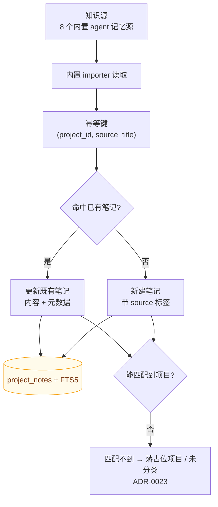

# 知识源导入

> **说明**：知识源导入不对用户脚本开放——进程内脚本插件运行时（yaegi，[ADR-0002](../adr/0002-c-end-repositioning.md)）已随 C11 移除，源清单全部内置、只随版本增长。

Repotory 向知识库幂等导入文档。8 个源全部**内置**，都是普通的 Go 实现（`plugin.KnowledgeImporter`）；进程内脚本插件运行时（yaegi）已随 C11 移除，不存在用户自定义导入源的入口。

读图：所有源**汇入同一条 upsert 路径**，幂等性由三元组 `(project_id, source, title)` 保证。因此重复导入是**更新**而非重复创建——重新导入不会把知识库越堆越脏。写入后由触发器同步 FTS 索引，导入的文档立刻可被 `repotory_notes_search` 命中。

最后一条分支自 ADR-0023 起不再丢弃文档：匹配不到项目的文档会**落到一个「落点项目」**——源带真实仓库路径的，按仓库名建/复用「未归类仓库」占位项目（该仓库日后被扫描到时自动转正为真实项目）；无仓库路径的全局记忆源（`openclaw` / `hermes` / `codebuddy-memory`）落到恒在的**「未分类」默认项目**。知识不再静默丢失，之后可在知识库的**整理**视图里把它们归口到真实项目。

## 内置知识源

| 源 | 触发方式 | 读取路径 | 说明 |
|----|---------|---------|------|
| `claude` | **自动** | `~/.claude/projects/*/memory/*.md` | 跳过 `MEMORY.md`；单文件超 100 KB 跳过 |
| `codex` | 手动 | `~/.codex/sessions/**/rollout-*.jsonl`、`~/.codex/archived_sessions/**` | 取每场会话的首条用户指令 + 末条助手回复 |
| `opencode` | 手动 | `$XDG_DATA_HOME`/`~/.local/share/opencode/storage/session/**/*.json` | 会话标题 + 摘要 |
| `openclaw` | 手动 | `~/.openclaw-autoclaw/workspace/*.md` | 仅单层，不递归；目标项目**可选**（未配置则落「未分类」） |
| `hermes` | 手动 | `$HERMES_HOME`/`~/.hermes/memories/{MEMORY,USER}.md` + `state.db`（`messages` 表，只读） | 记忆笔记 + 会话日志；目标项目**可选**（未配置则落「未分类」）；库表结构不认识则**整源报错** |
| `cursor` | 手动 | `<config>/Cursor/User/globalStorage/state.vscdb`（`CURSOR_STATE_DB` 可覆盖） | 只读；取首条提问 + 末条回复；格式不认识则**整源报错** |
| `codebuddy` | 手动 | `~/Library/Application Support/CodeBuddyExtension/Data/<uid>/<IDE>/history/*/index.json` + `messages/*.json` | 会话转录；取首条提问 + 末条回复；单文件坏掉只丢该会话 |
| `codebuddy-memory` | 手动 | `~/.codebuddy/memery/*.md` + `Public/.memories/*.mdc` | 用户记忆画像 + 写入规则记忆；目标项目**可选**（未配置则落「未分类」） |

「自动」指应用启动时随 `auto_import` 一起跑（**默认关**，需在 **设置 → 插件** 显式开启）；「手动」指只在 **设置 → 插件** 点该源时才导入 —— 这类源多为原始会话转录，量大且噪音高，不适合每次启动全量重扫。

### 项目归属

`claude` / `codex` / `opencode` / `cursor` / `codebuddy` 五个源自带项目线索（Claude 的 `-Users-x-Work-Foo` 目录名、会话的 `cwd`、OpenCode 的 `directory`、Cursor 的 `workspaceId → workspaceStorage/<id>/workspace.json` 里的 folder 路径、CodeBuddy 首条用户消息的 `Workspace Folder:`），取**路径最后一段**后按三级规则匹配：项目名精确匹配 → 仓库路径以该段结尾 → 项目名包含该段。匹配不上时（ADR-0023）**不再计入 skipped**：该文档落到按仓库名建的「未归类仓库」占位项目（`root_path` 为源仓库路径，日后扫描到同一仓库会把它转正为真实项目；Claude 用的是目录变形名、未必等于真实路径，占位不会自动转正，需在整理视图人工归口）。

`openclaw`、`hermes` 与 `codebuddy-memory` 的文件本身不含项目线索，因此目标项目由配置键指定：

| 配置键 | 作用 |
|--------|------|
| `openclaw_project` | openclaw 笔记归属的项目名或项目 ID |
| `hermes_project` | hermes 笔记归属的项目名或项目 ID |
| `codebuddy_project` | codebuddy-memory 笔记归属的项目名或项目 ID |

> 自 ADR-0023 起配置键是**可选**的：配了就把这三源的全部笔记归到指定项目；**未配置不再静默跳过**（旧行为），而是落到「未分类」默认项目，之后可在整理视图人工归口。因此导入不会再出现「一条都不生成」的情况。

### 导入统计

每次导入返回 `{created, updated, skipped}`：

- `created` — 新建的笔记数
- `updated` — 幂等命中并更新的笔记数（重复导入时全部落在这里）
- `skipped` — 因**超限 / 无法解析**而未写入的文档数。注意：ADR-0023 起「匹配不到项目」**不再计入 skipped**（改落占位 / 未分类项目）

所以「重复导入一遍全部变成 `updated=6`、`created=0`」正是幂等生效的证据，而非没有实际数据。

启动自动导入可在 **设置 → 插件** 开关（`auto_import` 配置项，**默认关**：读别人工具的记忆文件并写进本库属隐私相关行为，必须显式授权；升级时旧库若为"开"会被一次性归零，见 CHANGELOG）。手动触发见设置页。

### headless 模式

`cmd/server`（`--port` 启动的独立 API 服务）会执行与桌面应用相同的启动流程，因此知识源注册与 `auto_import` 行为完全一致：通过 `/api/rpc` 调用 `GetKnowledgeSources`、`TriggerKnowledgeImport`、`TriggerAllKnowledgeImports` 均可正常使用。

## 幂等导入语义

运行时按 `(project_id, source, title)` upsert：重复导入**更新**既有笔记而非重复创建。
